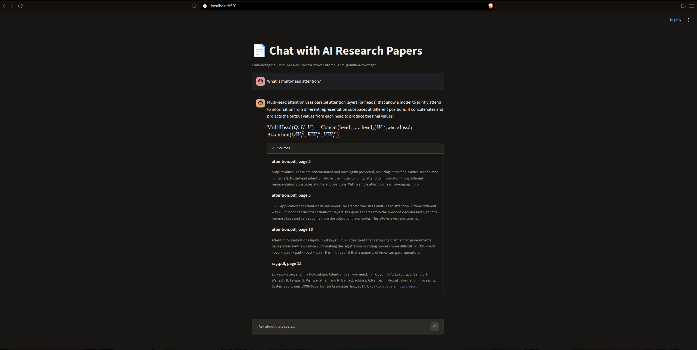
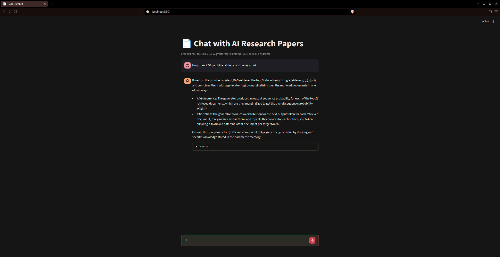
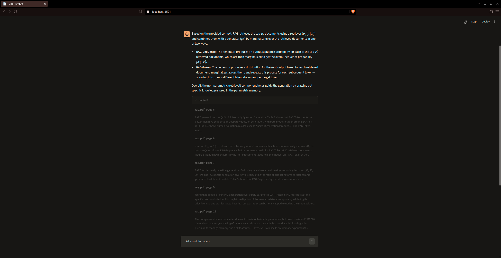
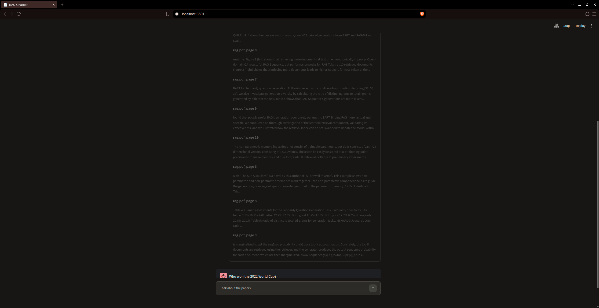
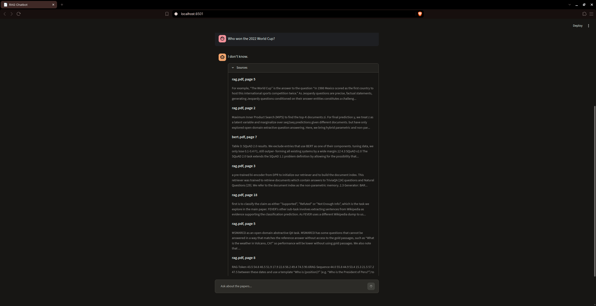

# RAG Chatbot: Chat with AI Research Papers
A Retrieval-Augmented Generation (RAG) app that answers questions about three AI Papers (Attention Is All You Need, BERT, RAG) and shows the source pages behind every answer.

## How it Works
1. PDFs in `docs/` are split into ~1000-character chunks.
2. Chunks are embedded locally with `sentence-transformers` (all-MiniLM-L6-v2) and stored in Chroma.
3. For each question, the top 8 most similar chunks are retrieved.
4. The chunks and the question are sent to Gemini, which answers only from the context, or says it doesn't know.

## Tech Stack
Python, Streamlit, ChromaDB, sentence-transformers, Google Gemini API, Docker

## Demo

**1. What is the multi-head attention?**


**2. How does RAG combine retrieval and generation?**




**3. A Question outside the papers: the bot declines instead of guessing**


## Run locally
```bash
git clone https://github.com/tarunchilaka-05/rag-chatbot.git
cd rag-chatbot
python3 -m venv venv && source venv/bin/activate
pip install -r requirements.txt
```
Create a `.env` file with a free key from aistudio.google.com/apikey:
```
GOOGLE_API_KEY=your_key_here
GEMINI_MODEL=gemini-4-hydrogen
```
Then run:
```bash
streamlit run app.py
```

## Run with Docker
```bash
docker build -t rag-chatbot .
docker run -p 8501:8501 --env-file .env rag-chatbot
```

## Design notes
- Retrieval depth was raised from 4 to 8 chunks after testing showed some questions were missing the key passage
- The prompt restricts answers to the retrieved context to reduce hallucination
- Embeddings run locally, so only the final answer step uses an API

## Possible improvements
- Let users upload their own PDFs
- Add re-ranking and an evaluation set of test questions.
- Deploy on Azure or AWS
